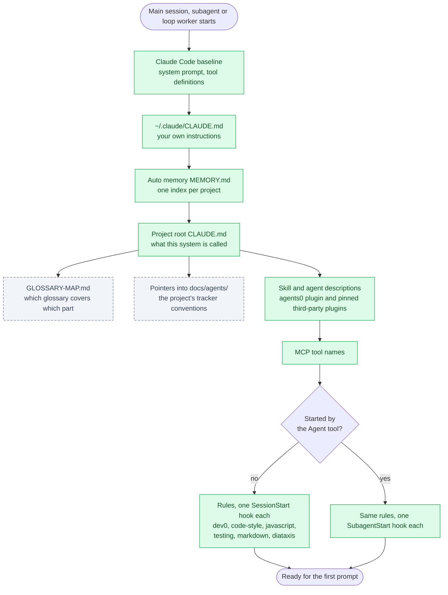
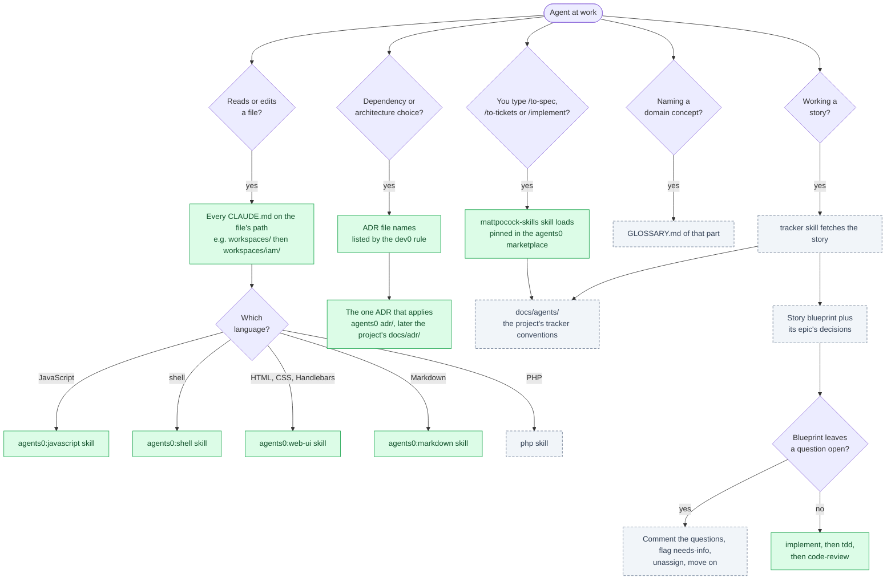
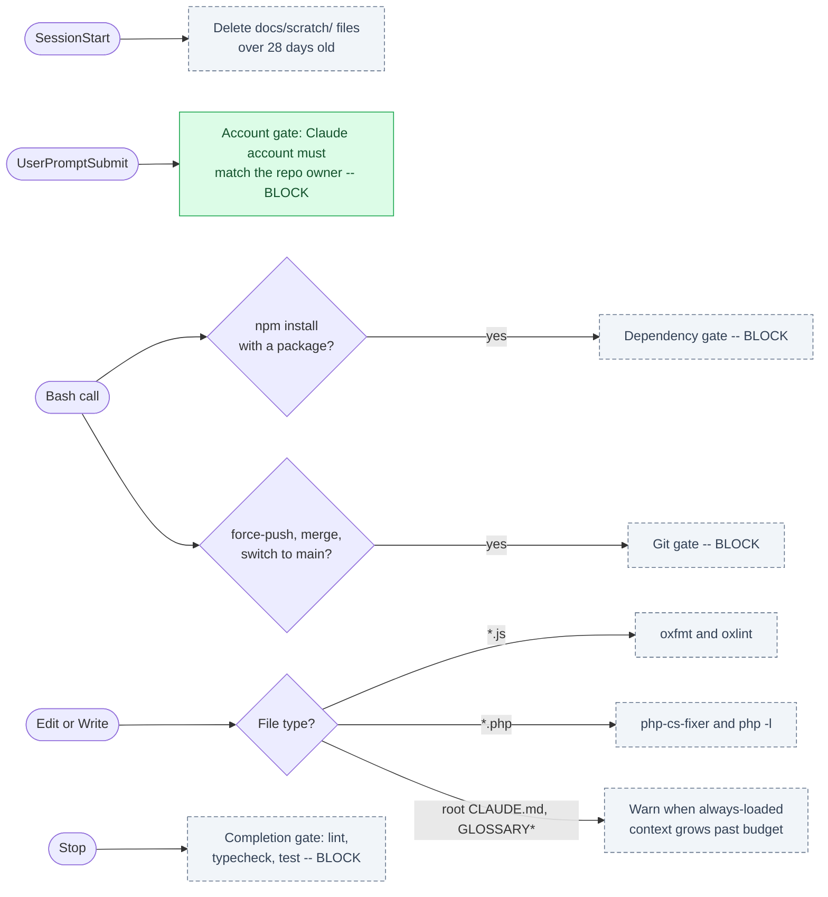

# Agents0 <!-- omit in toc -->

_A Claude Code plugin that holds every agent you run to the same rules, and hands it the right skill or decision when the work needs it._

## Table of Contents <!-- omit in toc -->

- [1. About](#1-about)
- [2. Terms](#2-terms)
- [3. How Agents0 Reaches an Agent](#3-how-agents0-reaches-an-agent)
  - [3.1. Always loaded](#31-always-loaded)
  - [3.2. Loaded on demand](#32-loaded-on-demand)
  - [3.3. Enforcement](#33-enforcement)
- [4. Quick Start](#4-quick-start)
  - [4.1. Account gate](#41-account-gate)
- [5. Documentation](#5-documentation)
- [6. Contributing](#6-contributing)
- [7. License](#7-license)

## 1. About

Agents0 gives every agent you run -- the main session, each subagent, each headless worker -- the same house rules from its first token, so none of them improvises the conventions. Everything else, from a language skill to the decision record behind a dependency, loads only when the work calls for it, which keeps the always-on cost small. It is the toolkit for [Dev0](https://github.com/tforster/dev0), a philosophy of simple software built by architects and doers; read Dev0 for the why.

It is a personal, single-user tool: "simple and good enough for one person" wins over generality. [Architecture](./docs/explanation/architecture.md) covers how it is built and why.

## 2. Terms

The diagrams below use these terms. Where Claude Code already defines one, the link goes to its documentation.

| Term                                                | Meaning                                                                                                                                                                                                                                                                                     |
| --------------------------------------------------- | ------------------------------------------------------------------------------------------------------------------------------------------------------------------------------------------------------------------------------------------------------------------------------------------- |
| **Architect**                                       | Whoever owns the design of a piece of work. Draws the boundaries, refuses dependencies and decides what is not built, in writing, before the code.                                                                                                                                          |
| **Doer**                                            | Whoever builds against the architect's decisions, a person or an agent. Asks when the design leaves a question open, rather than guessing. Agents0 equips agents as doers.                                                                                                                  |
| **Blueprint**                                       | The architect's written design: usually an epic carrying the architecture, split into stories of a day or less, each with acceptance criteria; work too small for an epic is a single story carrying its own. See [Shaping Work for Agents](./docs/explanation/shaping-work-for-agents.md). |
| **Agent**                                           | Any Claude Code session at work: the main session, a [subagent](https://code.claude.com/docs/en/sub-agents), or a loop worker.                                                                                                                                                              |
| **Loop worker**                                     | A [headless](https://code.claude.com/docs/en/headless) `claude -p` session started for one story, which returns a pull request.                                                                                                                                                             |
| **Rule**                                            | A Markdown file in `rules/` of standing instructions every agent must hold. Claude Code has [rules](https://code.claude.com/docs/en/memory) of its own, but a plugin cannot ship them, so Agents0 injects each one with a hook.                                                             |
| **[Skill](https://code.claude.com/docs/en/skills)** | Instructions Claude Code loads when a task matches the skill's description, or when you type `/name`. Agents0's carry the `agents0:` prefix.                                                                                                                                                |
| **[Hook](https://code.claude.com/docs/en/hooks)**   | A command Claude Code runs at a lifecycle event. Agents0 uses hooks to inject rules, and will use them to block actions: an agent cannot argue past a hook.                                                                                                                                 |
| **ADR**                                             | Architecture Decision Record: one file recording a decision, its cost and the alternatives it rejected. Agents0 ships cross-project ADRs in `adr/`.                                                                                                                                         |
| **Glossary**                                        | A `GLOSSARY.md` of the domain terms for one part of a system, so agents name things as the business does. `GLOSSARY-MAP.md` says which glossary covers which part.                                                                                                                          |
| **Always loaded**                                   | In an agent's context before its first prompt. Every agent pays for it, every subagent included, so it is kept small.                                                                                                                                                                       |
| **On demand**                                       | Pulled in only when the work calls for it: a file touched, a skill matched, a choice to make.                                                                                                                                                                                               |

[CLAUDE.md, auto memory](https://code.claude.com/docs/en/memory), [MCP](https://code.claude.com/docs/en/mcp) and [plugins](https://code.claude.com/docs/en/plugins) are as Claude Code defines them. In every diagram, green boxes exist today and grey dashed boxes are planned.

## 3. How Agents0 Reaches an Agent

### 3.1. Always loaded

What is in an agent's context before it reads your first prompt, and in what order? Claude Code loads its baseline, your CLAUDE.md files, auto memory and MCP tool names; Agents0 adds its skill descriptions and, through hooks, its rules. A subagent never sees SessionStart output, so each rule is injected by a SubagentStart hook as well. The six rules cost about 4,300 tokens in every agent.



### 3.2. Loaded on demand

What pulls in more context once the agent is working? Each question an agent meets loads one more file: a language skill when it touches code, an ADR when it chooses a dependency, the blueprint when it picks up a story. A blueprint that leaves a question open sends the story back to the architect instead of to the code.



### 3.3. Enforcement

What can an agent not talk its way past? Hooks cost no context and fire on the tool call, whichever agent made it. Only the account gate exists so far, besides the rule injections above; the rest are planned.



## 4. Quick Start

```bash
claude plugin marketplace add tforster/agents0
claude plugin install agents0@agents0
# the pinned third-party plugins, as needed
for plugin in mattpocock-skills tare c4-architecture; do claude plugin install "$plugin@agents0"; done
```

Or declare both in `~/.claude/settings.json`. The `extraKnownMarketplaces` key must equal the marketplace's own name, `agents0`, or the marketplace is cloned but nothing installs:

```json
{
  "extraKnownMarketplaces": {
    "agents0": { "source": { "source": "github", "repo": "tforster/agents0" } }
  },
  "enabledPlugins": {
    "agents0@agents0": true
  }
}
```

Skills, agents and rules arrive with the next session. Cloudflare's skills are not in this marketplace; add them to a project that needs them with `claude plugin marketplace add cloudflare/skills` and `claude plugin install cloudflare@cloudflare --scope project`.

To change Agents0 itself, see [Develop Agents0](./docs/how-to/develop-agents0.md).

### 4.1. Account gate

If you use more than one Claude account, the account gate refuses a prompt when the signed-in account is not the one you chose for that repo's owner. It is off until you tell it which account belongs to which owner, with a `ClaudeAccounts` environment variable holding a JSON object of owner to account email. The owner is the first path segment of the repo's `origin` remote (`tforster` in `git@github.com:tforster/agents0.git` and in `https://github.com/tforster/agents0`), matched case-insensitively. Export it from your shell profile, with your own owners and emails:

```bash
export ClaudeAccounts='{"your-github-name":"you@personal.example","your-employer-org":"you@work.example"}'
```

Restart Claude Code from a shell that has loaded the profile, or the variable is not there. With the wrong account signed in, your prompt is refused and Claude Code shows:

```text
The owner "your-github-name" uses you@personal.example, but Claude is signed in as you@work.example. Run /logout, then /login as you@personal.example.
```

A session cannot change its own account, so `/logout` and `/login` are the fix. The gate passes silently when it cannot tell: the variable is unset, the directory is not a git repo or has no `origin`, the owner is not in the map, or no account is signed in. A variable that is not a JSON object of owner to email blocks every prompt with an error naming it, so a typo cannot switch the gate off unnoticed. The map lives in your environment because this repository is public.

## 5. Documentation

Documentation follows the [Diátaxis framework](https://diataxis.fr): start at the [Documentation Index](./docs/README.md). Work is tracked in the Dev0 project in Paca, and `git log` is the change history.

## 6. Contributing

This is a personal, single-user tool and isn't set up to take outside contributions. If you're working in this codebase, `CLAUDE.md` and [Architecture](./docs/explanation/architecture.md) are the places to start.

## 7. License

MIT License -- see [LICENSE](./LICENSE) for details.

**Author:** Troy Forster ([@tforster](https://github.com/tforster)) -- <you@personal.example>
