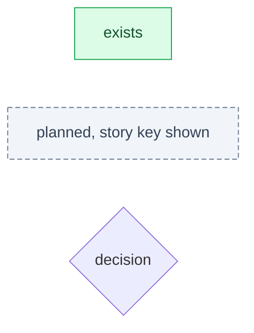
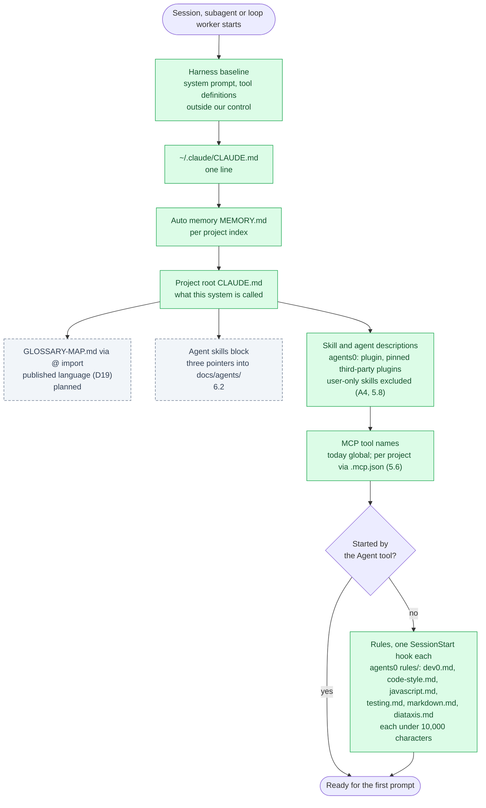
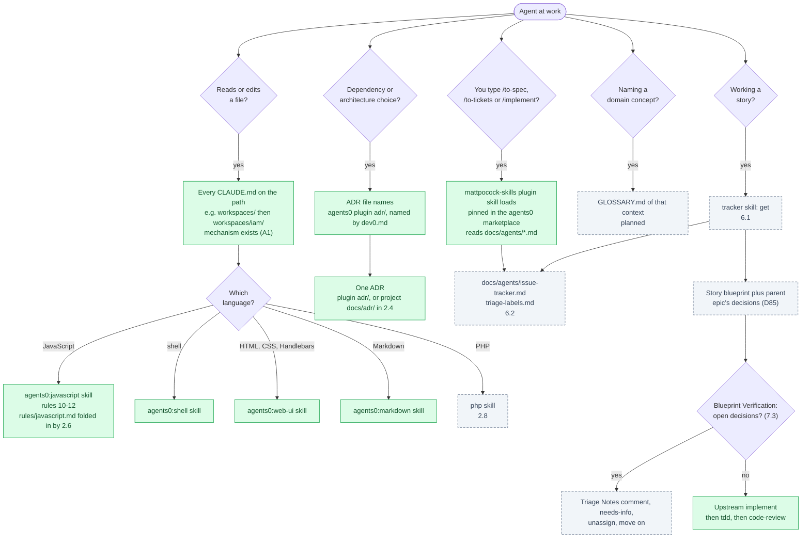
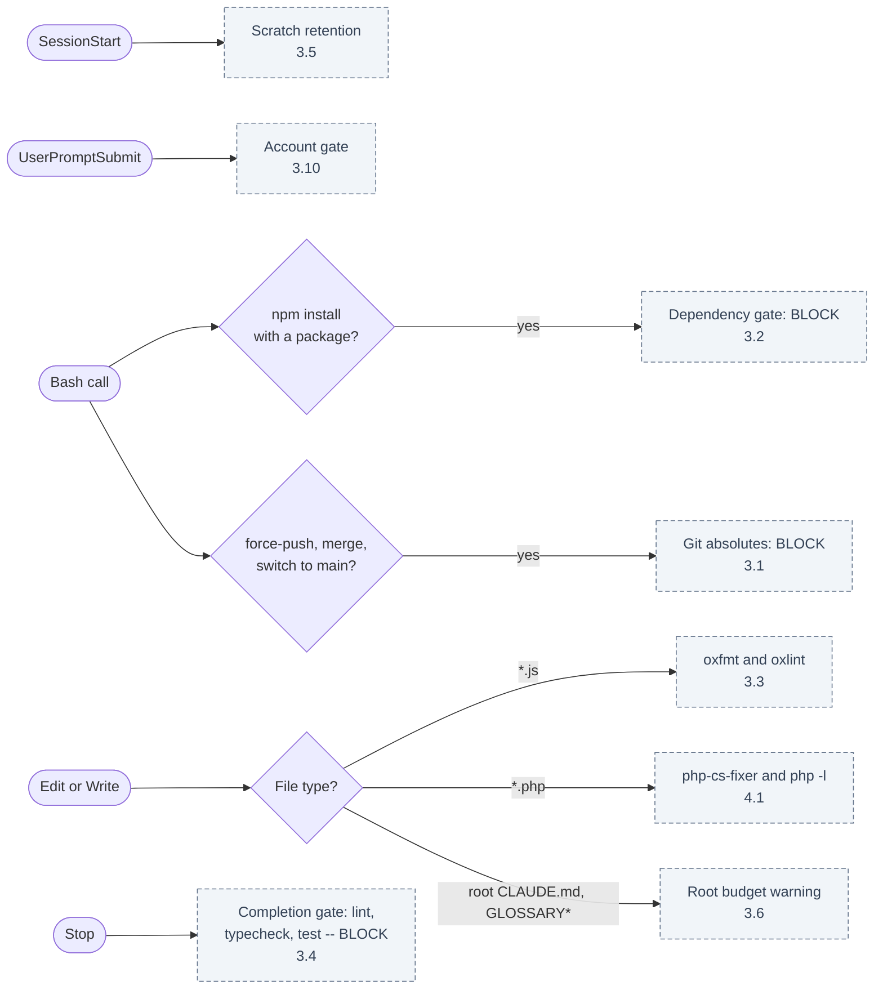

# Agent Context Map <!-- omit in toc -->

What an agent -- a session you start, a subagent, or a loop worker -- has in context, in what order it arrives, and what pulls each further file in. Each box is marked as it stands on 2026-10-18, after DEV0-67 moved Agents0 to a Claude Code plugin: **exists**, or **planned** with the story that builds it. Decision IDs refer to `2026-09-11-dev0-framework.md`.

## Table of Contents <!-- omit in toc -->

- [1. Legend](#1-legend)
- [2. Always loaded, at start](#2-always-loaded-at-start)
- [3. Loaded on demand, during work](#3-loaded-on-demand-during-work)
- [4. Enforcement, not context](#4-enforcement-not-context)
- [5. Never loaded by an agent](#5-never-loaded-by-an-agent)

## 1. Legend

Everything in §2 is paid by **every** agent, including each subagent and loop worker (A2) -- except the rules, which a subagent does not receive -- so it is the budget that matters: D25 targets ~1,200 tokens for the global rules, D63 caps the root `CLAUDE.md` plus imports at 6 KB.

## 2. Always loaded, at start

Plugins cannot ship rules, so the `agents0` plugin injects each file in `rules/` through its own SessionStart hook: hook output over 10,000 characters is cut to a preview. The six rules are about 4.3k tokens in every main session and `claude -p` worker. A subagent started with the Agent tool gets no SessionStart context, so it sees none of them; native `~/.claude/rules/` used to reach it. 2.6 and 2.7 demote the language rules into skills.

## 3. Loaded on demand, during work

The upstream skills exist but have nothing to read yet: `docs/agents/` arrives with 6.2. Whether a loop worker can start `implement` at all is A3 (7.5).

## 4. Enforcement, not context

Hooks cost no context and cannot be talked past (D30, D32). They fire on the tool call, whichever agent made it.

None of Dev0's enforcement hooks exist yet. The `agents0` plugin's only hooks inject rules at SessionStart (§2), which is context, not enforcement; other plugins run their own (`claude-mem`).

## 5. Never loaded by an agent

- `DEV0.md` (2.2): the tenets and decision matrix, written for the architect. The single exception is the Dev0 review agent (7.4), whose job is judgement (D59).
- The framework design doc and this map: `docs/scratch/`, for you.

[← Back to Documentation Home](../README.md)
